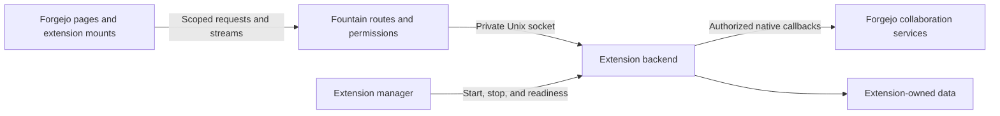

# Fountain

**Forgejo with native extensions.**

Fountain is a maintained [Forgejo](https://forgejo.org/) fork that lets you build
applications into your software forge. It combines Forgejo's Git hosting, issues,
pull requests, organizations, permissions, Actions, and package registry with
independently installed extension backends and browser interfaces.

An extension can add a repository workspace, keep a panel open while someone
browses issues and code, or run authorized background operations against native
repositories. Fountain supplies the integration with Forgejo; each extension owns
its application logic, interface, and data. Installing an extension does not
require rebuilding the host.

The extension interfaces are under active development. The maintained branch is
[`codex/fountain-extensions`](https://github.com/veighnsche/forgejo-ext/tree/codex/fountain-extensions).
Use a matching host and SDK source revision when building an integration.

## What Fountain adds

| Capability | What it provides |
| --- | --- |
| Native pages | Global, repository, user-settings, and administrator contributions in Forgejo's layouts and navigation, with declared subroutes. |
| Persistent panels | Browser components that retain their DOM, local state, and streams across supported native page transitions. A page and panel can share one retained instance. |
| Extension backends | Separately built executables with a lifecycle handshake, private Unix-socket transport, and a persistent data directory. |
| Native identity and access | Session-aware HTTP and WebSocket requests, current actor and repository reads, and contribution permissions checked by the host. |
| Background collaboration | An independent authorization path for native snapshots and conditional issue, Git, pull-request, review, and merge operations. |
| Package lifecycle | Local installation, verified catalog acquisition, live administrator enable/disable, required-package readiness, and persisted requested state. |

The bundled [example application](contrib/extensions/example) demonstrates scoped
pages and a persistent notes panel. [SodaOS](https://github.com/LevitateOS/sodaos)
is a downstream consumer that supplies its own workspace, automation, and
appliance integration. Fountain can run independently; its release image includes
the forge and extension host without preinstalling Soda's application packages.

## How an extension works



A package contains an `extension.json` manifest and an executable. Packages that
contribute UI also include browser assets:

```text
example/
├── extension.json
├── backend
└── assets/
    ├── page.js
    └── panel.js
```

The [manifest](sdk/manifest.go) declares identity, capabilities, pages, panels,
permissions, and optional lifecycle-controller relationships. Fountain validates
the package, starts its backend, and serves its contributions through native
routes. The backend implements the lifecycle handshake and private HTTP interface;
the [Go SDK](sdk) provides these through `Serve(Application)` and uses HashiCorp
go-plugin for the control handshake.

Browser modules export `mount(root, context)`. The host supplies scoped `request`,
`stream`, and `navigate` functions and drives the component's lifecycle. The
[TypeScript contract](sdk/browser/extension-contract.d.ts) describes presentation
updates, suspension, resumption, and retirement. It is a type-only interface; the
host provides the runtime helpers.

The host manages package processes and admission. Extensions own their workflows
and persistent data, accessed through the SDK's `DataDir()`. Forgejo's database
and internal service packages remain behind the native API boundary.

## Native UI and permissions

Pages occupy host-defined routes. A manifest selects a slot and may declare
bounded subordinate routes, such as `/workspace/requests/{request}`.

| Scope | Available page routes |
| --- | --- |
| Global | `/workspace`, `/feed`, `/applications`, `/tailnet` |
| Repository | `/{owner}/{repo}/workspace` |
| User settings | `/user/settings/workspace`, `/user/settings/identity` |
| Administrator | `/admin/workspace` |

Route claims must be unique within their scope. Contributions use Forgejo's
signed-in browser session and native account, repository, and administrator
checks. An extension can further restrict access through a contribution
authorizer. Observing a repository in the browser context does not grant
permission to operate on it.

Persistent panels retain their mounted root and resources during supported
navigation. A shared page/panel owner changes presentation without creating a
second application instance. Session changes and revoked access retire affected
mounts and transports. Authentication flows, errors, and routes outside the
supported transition contract retain normal document navigation. The
[extension guide](contrib/extensions/README.md#browser-lifecycle) describes the
browser contract and its current coverage.

**Extensions are administrator-trusted code.** Their backend runs as the host's
OS user, and their JavaScript executes on the forge's origin. Process separation
provides lifecycle management, not a sandbox for untrusted packages.

## Background collaboration

Background work has its own installation identity and authorization, independent
of a browser tab. Supported clients use the private callback transport, enrolled
native actors, and scoped credentials. Closing a browser session does not grant
or revoke those separate background permissions; installation, actor, token,
repository, and operation checks still apply.

The [native operation service](services/nativeoperation) supports:

- Creating and editing issues and changing their dependency graph.
- Publishing Git refs and creating pull requests.
- Submitting reviews, resolving review threads, and requesting reviewers.
- Applying issue lifecycle changes and publishing comments.
- Merging an exact pull-request candidate using fast-forward-only semantics.

Clients can read native snapshots of issues, comments, dependencies, pull
requests, reviews, checks, refs, ancestry, and permissions. Writes carry an
operation identity, expected native revision, and deadline. Repeating an
identical operation returns its recorded result; changing its intent under the
same ID is rejected. The operation ledger records effects, cancellation, and
completion separately so callers can distinguish an uncommitted write from an
uncertain or partially completed outcome.

Fountain owns native authorization and collaboration effects. The extension
decides what work to request and manages its own planning, execution, and policy.
See the [background SDK](sdk/background.go), [snapshot types](sdk/snapshot.go),
and [supported-operation handshake](sdk/operations.go) for the concrete contracts.

## Build and try Fountain

Build from this repository's maintained branch. Install Git, GNU Make, a C
compiler, Go, and Node.js with npm; the repository records its toolchain inputs in
[go.mod](go.mod), [.node-version](.node-version), and
[package.json](package.json). The upstream
[build guide](https://forgejo.org/docs/next/contributor/from-source/) covers
platform prerequisites.

```sh
git clone --branch codex/fountain-extensions https://github.com/veighnsche/forgejo-ext.git fountain
cd fountain
npm ci
TAGS="bindata timetzdata sqlite sqlite_unlock_notify" make build
./gitea web
```

The Makefile retains the upstream `gitea` executable name. On a fresh local
installation, open `http://localhost:3000` and complete Forgejo's setup. Standard
forge administration is covered by the
[Forgejo administrator guide](https://forgejo.org/docs/latest/admin/).

### Try the example extension

From the source checkout, build its backend and check its browser entries:

```sh
mkdir -p .artifacts/packages/example/assets
go build -o .artifacts/packages/example/backend ./contrib/extensions/example
./node_modules/.bin/tsc -p sdk/browser
cp contrib/extensions/example/extension.json .artifacts/packages/example/
cp contrib/extensions/example/assets/*.js .artifacts/packages/example/assets/
```

Stop the local server and add this section to its `custom/conf/app.ini`:

```ini
[extensions]
ENABLED = true
PATH = data/extensions
```

Using the same configuration, work path, and service account as the server:

```sh
./gitea --config ./custom/conf/app.ini --work-path "$PWD" extensions install .artifacts/packages/example
./gitea --config ./custom/conf/app.ini --work-path "$PWD" extensions enable example
./gitea --config ./custom/conf/app.ini --work-path "$PWD" extensions list
./gitea --config ./custom/conf/app.ini --work-path "$PWD" web
```

Sign in and open `/workspace`. The example adds global, repository, user-settings,
and administrator pages plus a notes panel with per-user storage and an admitted
WebSocket stream. Its source imports the public SDK without importing the host's
models or services.

## Operating extensions

Extensions are disabled by default. `PATH` selects package storage; private data
lives under `PATH/.data/{id}` and survives replacement and disabling. Include
extension data in backups alongside the forge's normal persistent state.

The CLI handles local package installation, replacement, removal, and next-start
activation while the host is stopped. The running server's `/admin/extensions`
page can enable and disable optional packages without restarting Fountain.

For managed distribution, `CATALOG_PATH` selects a trusted catalog of HTTPS
archives with exact sizes and SHA-256 checksums. `REQUIRED_IDS` identifies
catalog packages that must be ready before the host reports readiness. Optional
packages reconcile after core startup; an optional backend failure isolates that
package. Required packages cannot be disabled through normal administrator
controls. Packages with external effects can use a declared lifecycle controller
for activation and cleanup.

The [lifecycle and release contract](docs/fountain-release.md#extension-lifecycle-contract-rcx-2)
covers catalog configuration, durable state, controllers, maintenance, and
recovery. The release tooling produces a native Linux amd64 image, executable,
source archives, and provenance metadata; see
[Fountain releases](docs/fountain-release.md) for qualification and publication.

## Development and documentation

| Area | Start here |
| --- | --- |
| Authoring an extension | [Extension guide and example](contrib/extensions/README.md) |
| Backend and browser interfaces | [Go SDK](sdk) · [Browser contract](sdk/browser/extension-contract.d.ts) |
| Package installation and catalogs | [Package store](modules/extensions) |
| Runtime and lifecycle | [Extension manager](services/extensions) |
| Native routes, proxying, and administration | [Web handlers](routers/web/extensions) |
| Browser mounts and navigation | [Mount implementation](web_src/js/features/extension-mount.js) · [Native integration](web_src/js/features/extensions.js) |
| Conditional operations and persisted results | [Service](services/nativeoperation) · [Models](models/nativeoperation) |
| Testing and contributions | [Fountain testing](docs/fountain-testing.md) · [Contribution guide](CONTRIBUTING.md) |

Required push CI covers source checks, SDK and native tests, race detection,
SQLite/PostgreSQL contracts, frontend checks, and packaging. Deep CI adds the
broader regression and browser journeys. The example's
[browser test](tests/e2e/fountain.test.e2e.ts) exercises retained notes, native
navigation, administrator enable/disable, and session revocation. Downstream
applications still need their own integration tests.

After committing a clean candidate, the repository's push entry point is:

```sh
bash tools/fountain-push.sh
```

It qualifies that exact commit before updating the maintained branch. See the
[testing guide](docs/fountain-testing.md) for local checks and CI requirements.

## Upstream and license

Fountain builds on the work of the Forgejo community and its upstream
contributors. Forgejo's [documentation](https://forgejo.org/docs/latest/) remains
the reference for the underlying forge; this repository documents Fountain's
extension interfaces and release process.

The combined project is distributed under [GPL-3.0-or-later](LICENSE).
Individual files and third-party components retain their own license notices,
including the MIT notices on the extension SDK.
